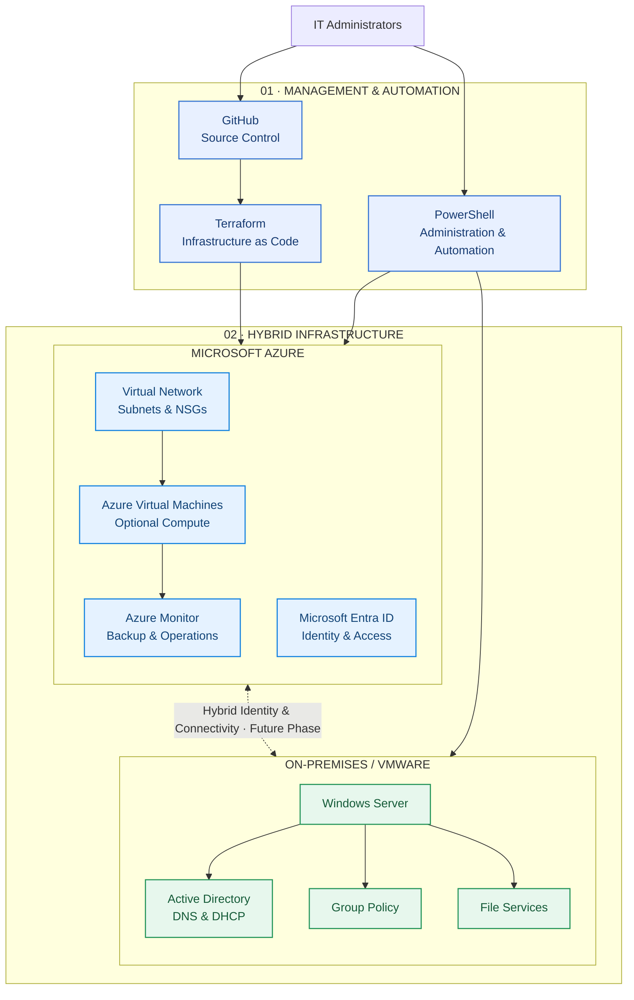

# Microsoft Enterprise Hybrid Infrastructure

**Design · Automate · Operate**

A portfolio project focused on designing, implementing, and managing an enterprise hybrid infrastructure using **Microsoft Azure, Terraform, Windows Server, PowerShell, and VMware**.

This project explores real-world enterprise IT infrastructure practices, including cloud networking, Windows Server administration, identity and access management, infrastructure automation, monitoring, security, and hybrid cloud operations.

> **Project Stage:** Initial development. This repository provides the project foundation, architecture design, initial Terraform configuration, and starter automation scripts. Implementation and validation will be documented progressively.

---

## 1. Project Objectives

The goal is to build a practical enterprise hybrid infrastructure environment that demonstrates the following capabilities:

- Design and provision Azure infrastructure using Terraform.
- Build an enterprise Windows Server infrastructure with Active Directory, DNS, DHCP, and Group Policy.
- Understand and implement Microsoft Entra ID and hybrid identity management.
- Automate infrastructure administration using PowerShell.
- Apply enterprise networking, security, and access control practices.
- Implement monitoring, backup, troubleshooting, and operational procedures.
- Document infrastructure design, deployment, and validation processes.

## 2. Architecture Overview

The project follows a hybrid infrastructure architecture combining cloud resources, on-premises services, and centralized administration.



### Architecture Components

| Layer | Components | Purpose |
|---|---|---|
| Management | GitHub, Git, Terraform, PowerShell | Source control and automation |
| Azure Cloud | VNet, Subnets, NSG, VMs | Cloud infrastructure |
| Windows Infrastructure | Windows Server, AD DS, DNS, DHCP, GPO | Enterprise IT services |
| Identity | Microsoft Entra ID, RBAC | Identity and access management |
| Operations | Azure Monitor, Backup | Monitoring and recovery |
| Hybrid Integration | VMware, Azure Arc, VPN | Hybrid management and connectivity |

*The architecture represents the target design. Components marked as future work are not yet deployed.*

## 3. Technology Stack

| Category | Technologies |
|---|---|
| Cloud Platform | Microsoft Azure |
| Infrastructure as Code | Terraform |
| Operating Systems | Windows Server, Linux |
| Directory Services | Active Directory Domain Services |
| Identity Management | Microsoft Entra ID, Azure RBAC |
| Network Services | DNS, DHCP, NSG, TCP/IP |
| Automation | PowerShell, Azure CLI |
| Virtualization | VMware |
| Monitoring | Azure Monitor, Log Analytics |
| Backup & Recovery | Azure Backup |
| Source Control | Git, GitHub |

## 4. Repository Structure (Initial)

The following is the **initial repository structure**. It establishes the main project areas and will expand as additional infrastructure components and automation workflows are implemented.

```text
microsoft-enterprise-hybrid-infrastructure/
│
├── README.md
├── .gitignore
├── LICENSE
│
├── architecture/                  # Initial architecture documentation
│   ├── enterprise-architecture.md
│   └── network-design.md
│
├── terraform/                     # Initial Terraform configuration
│   └── environments/
│       └── dev/
│           ├── versions.tf
│           ├── providers.tf
│           ├── variables.tf
│           ├── main.tf
│           ├── outputs.tf
│           └── terraform.tfvars.example
│
├── windows-server/                # Windows infrastructure design
│   ├── active-directory/
│   │   └── design.md
│   ├── dns-dhcp/
│   │   └── design.md
│   └── group-policy/
│       └── design.md
│
├── powershell/                    # Starter automation scripts
│   ├── server-health-check/
│   │   └── Get-ServerHealth.ps1
│   └── user-provisioning/
│       └── New-LabUser.ps1
│
└── docs/                          # Project documentation
    ├── deployment-guide.md
    ├── security-design.md
    ├── troubleshooting.md
    └── cost-management.md
```

### Directory Responsibilities

| Directory | Responsibility |
|---|---|
| `architecture/` | Enterprise architecture and network design |
| `terraform/` | Azure infrastructure provisioning |
| `windows-server/` | Active Directory and Windows Server services |
| `powershell/` | Infrastructure administration and automation |
| `docs/` | Deployment, security, troubleshooting, and operations |

Additional directories, such as `azure/`, reusable Terraform modules, monitoring configurations, and hybrid identity implementations, will be introduced as the project evolves.

## 5. Implementation Roadmap

The project is organized into progressive phases, moving from infrastructure foundations to enterprise hybrid operations.

| Phase | Focus | Key Deliverables |
|---|---|---|
| Phase 0 | Project Foundation | GitHub repository, architecture, documentation |
| Phase 1 | Azure Infrastructure | Terraform, VNet, Subnets, NSGs, optional VMs |
| Phase 2 | Windows Server | AD DS, DNS, DHCP, Group Policy |
| Phase 3 | Identity & Access | Entra ID, users, groups, RBAC, hybrid identity |
| Phase 4 | Automation | PowerShell administration and provisioning |
| Phase 5 | Monitoring & Backup | Azure Monitor, Log Analytics, Backup |
| Phase 6 | Hybrid Integration | VMware, Azure Arc, hybrid connectivity |
| Phase 7 | Validation & Operations | Troubleshooting, security review, documentation |

### Implementation Status

| Component | Status |
|---|---|
| Repository foundation | Scaffolded |
| Architecture documentation | Initial |
| Azure Terraform configuration | Initial code |
| Azure deployment | Not yet deployed |
| Windows Server / AD DS | Design |
| PowerShell automation | Starter scripts |
| Entra ID integration | Planned |
| Monitoring and backup | Planned |
| VMware / Azure Arc | Planned |

Status definitions:

- **Scaffolded:** Initial repository structure and files are created.
- **Initial code:** Configuration has been written but is not yet fully validated.
- **Design:** Architecture and implementation approach are documented.
- **Implemented:** The component has been configured or deployed.
- **Validated:** Functionality has been tested and evidence recorded.
- **Planned:** Future implementation.

## 6. Terraform Deployment

The initial Terraform configuration provisions the following Azure resources:

- Resource Group
- Virtual Network
- Workload Subnet
- Network Security Group
- Optional Windows Server Virtual Machine

The Windows VM is disabled by default to control cloud costs.

### Prerequisites

- Azure subscription
- Azure CLI
- Terraform CLI
- Git

### Authentication

```bash
az login
az account list --output table
az account set --subscription "<YOUR_SUBSCRIPTION_ID>"
```

### Initialize and Validate

```bash
cd terraform/environments/dev

terraform init
terraform fmt -recursive
terraform validate
```

### Review Deployment Plan

```bash
terraform plan -out=tfplan
```

Review the proposed changes before deploying.

### Apply Infrastructure

```bash
terraform apply tfplan
```

The initial deployment focuses on Azure networking. The optional VM can be enabled later through the `deploy_vm` variable.

### Clean Up

```bash
terraform destroy
```

Always review the destruction plan before confirming.

## 7. Windows Server & Identity

The Windows Server workstream focuses on common enterprise infrastructure services.

Planned components:

- Active Directory Domain Services
- Organizational Units and Security Groups
- DNS and DHCP
- Group Policy Management
- File Server Services
- Microsoft Entra ID integration
- Role-Based Access Control

These services will initially be documented and developed as lab configurations. Actual deployment and validation will be recorded separately.

## 8. PowerShell Automation

PowerShell is used to automate common infrastructure administration tasks.

Initial scripts:

| Script | Purpose |
|---|---|
| `Get-ServerHealth.ps1` | Collects operating system, uptime, memory, and disk information |
| `New-LabUser.ps1` | Demonstrates controlled Active Directory user provisioning |

Future automation:

- Active Directory user and group management
- Bulk user provisioning
- Server health reporting
- Azure VM administration
- Service and event log checks
- Microsoft Graph administration

## 9. Security & Operations

Security and operational reliability are core design considerations.

Key areas:

- Least-privilege access and Azure RBAC
- Network segmentation and NSG rules
- Secure administrative access
- Credential and secret management
- System monitoring and alerting
- Backup and recovery planning
- Troubleshooting and incident documentation
- Azure resource and cost management

No credentials, private keys, Terraform state files, or deployment plan files should be committed to GitHub.

## 10. Future Enhancements

As the project develops, the following capabilities will be considered:

- Reusable Terraform modules
- Separate development and testing environments
- Azure Monitor and Log Analytics integration
- Azure Backup and recovery validation
- Microsoft Entra ID identity management
- Azure Arc for hybrid server management
- Site-to-site VPN architecture
- Automated Terraform and PowerShell validation through GitHub Actions

## Project Goal

Build a secure, scalable, and well-managed Microsoft enterprise hybrid infrastructure that demonstrates practical skills in cloud infrastructure, Windows Server administration, automation, identity management, and IT operations.

---

**Disclaimer:** This is an independent learning and portfolio project. It is not affiliated with or endorsed by Microsoft. All infrastructure deployments and configurations must be reviewed for security, suitability, and cost before use.